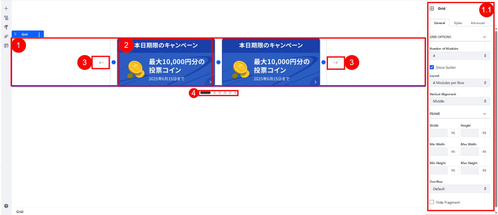
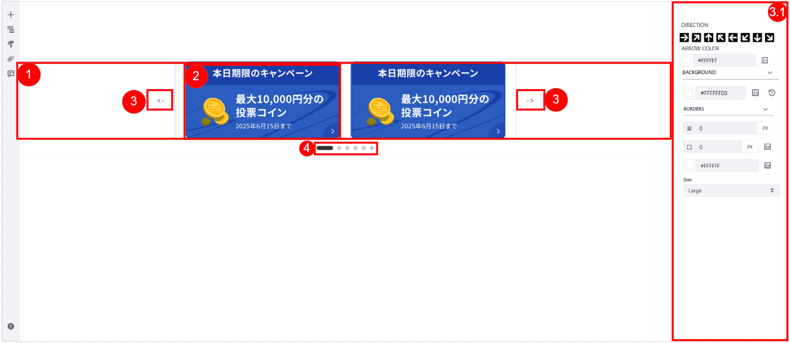
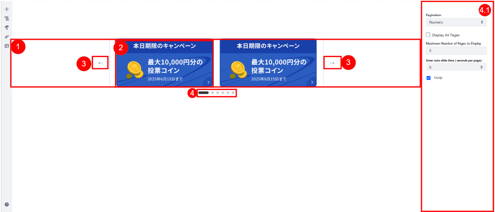
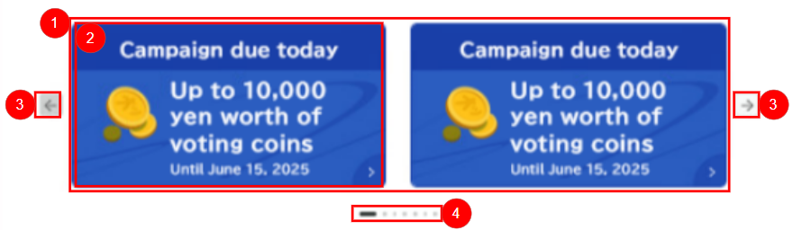
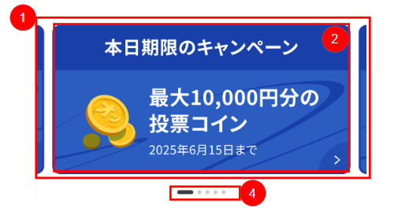

# 【CMSコンテンツ】コンポーネント仕様書_CDBSPxxxx_Campaign Due Today

## 1. 表紙

<h1 style="text-align:center;">

ネット投票システム(RAISE)／コンポーネント仕様書

</h1>

<h3 style="text-align:center;">

```
2026 年 05 月 19日
第 00.01 版
オッズ・パーク株式会社
```

</h3>

## 2. 変更履歴

| 版数  | 変更日         | 変更ID | 変更箇所 | 変更内容 | 更新者 | 承認日付       | 承認者 |
| ----- | -------------- | :----- | -------- | -------- | ------ | -------------- | ------ |
| 00.01 | 2026年05月21日 | -      | -        | 新規作成 |        | 2026年05月21日 |        |

## 3. インプット一覧

| ドキュメント     | 詳細                 | ID/No                                       | 名称                                                                                                                                                                                                                                                      |
| ---------------- | -------------------- | ------------------------------------------- | --------------------------------------------------------------------------------------------------------------------------------------------------------------------------------------------------------------------------------------------------------- |
| 要件定義書       | 業務フロー           | A06-050106 (A06-050106-01_キャンペーン登録) | キャンペーン_運用管理                                                                                                                                                                                                                                     |
| 要件定義書       | 業務処理定義書       | A06-006 (システム化業務詳細)                | キャンペーン運用管理                                                                                                                                                                                                                                      |
| 要件定義書       | システム化業務説明書 | A06-161 (別紙_画面帳票項目)                 | 投票促進・リテンション                                                                                                                                                                                                                                    |
| 現行サイト       |                      |                                             | [https://www.oddspark.com/campaign/campaign.html](https://www.oddspark.com/campaign/campaign.html)                                                                                                                                                           |
| 現行サイト       |                      |                                             | [https://mockup.opnextlab.click/proto-pages/campaign/cm_cp_list01](https://mockup.opnextlab.click/proto-pages/campaign/cm_cp_list01)                                                                                                                         |
| ワイヤーフレーム |                      |                                             | [OddsPark_Phase2-2_画面デザイン確認用](https://www.figma.com/design/gmMKkIzJDJG1LHp6tc6FmK/OddsPark_Phase2-2_%E7%94%BB%E9%9D%A2%E3%83%86%E3%82%99%E3%82%B5%E3%82%99%E3%82%A4%E3%83%B3%E7%A2%BA%E8%AA%8D%E7%94%A8?node-id=629-72827&t=ETQoh05uqY2RyUP6-1) |

## 4. Author Configurations

### 4.1 画面レイアウト (Screen Layout)







### 4.2 項目説明 (Item Description)

* Other fields captured in the UI belong to OOTB of CMS and are not related to this requirement. Refer to official guide document from Liferay here: https://learn.liferay.com/w/dxp/content-management-system/web-content/web-content-articles/creating-web-content-articles

| 項番 | 項目名 (業務)            | 種類                             | 必須 | OOTB | 備考                                                                                                                                                                                                                                                                                                                                                                                                                                                                                                                                                                                                                                                                                                                                |
| ---- | ------------------------ | -------------------------------- | ---- | ---- | ----------------------------------------------------------------------------------------------------------------------------------------------------------------------------------------------------------------------------------------------------------------------------------------------------------------------------------------------------------------------------------------------------------------------------------------------------------------------------------------------------------------------------------------------------------------------------------------------------------------------------------------------------------------------------------------------------------------------------------- |
| 1    | Carousel                 | Component                        | O    | O    | Cho phép user thiết kế và tạo giao diện hiển thị cho Carousel                                                                                                                                                                                                                                                                                                                                                                                                                                                                                                                                                                                                                                                               |
| 1.1  | Bố trí Carousel        | DropDown/ Checkbox               | O    | O    | Cho phép User chọn số module trong 1 Grid với giá trị từ 1-5<br />+ Khi kéo thả Grid mặc định là 2<br />+ Checkbox: bật/tắt Gutter để ngăn cách các Campaign<br />+ Căn chỉnh dọc nội dung của Grid gồm: Top/ Middle/ Bottom<br />+ Số banner trên 1 hàng:  mặc định là số module đã chọn trên hàng/ Tùy chọn mỗi hàng 1 module                                                                                                                                                                                                                                                                                                                                                        |
| 2    | Banner Card              | Input Text/ Attachment          | O    | O    | Cho phép user cấu hình nội dung tổng quan của card campaign:<br />+ Mỗi Banner Card đại diện cho 1 Campaign duy nhất trong hệ thống<br />+ Drag and drop để thay đổi vị trí các Card<br />+ Title: Nhập tiêu đề của từng Card hiển thị trên UI<br />+ Content: Nhập nội dung mô tả, bao gồm thông tin về phần thưởng hoặc chi tiết campaign<br />+ Image: Double click để hiển thị cấu hình ảnh và gắn ảnh <br />+ Link : Cấu hình URL điều hướng khi user click vào Card ( tham khảo Liferay User Manual: [Link](https://learn.liferay.com/w/dxp/sites/creating-pages/page-fragments-and-widgets/using-fragments/configuring-fragments/fragment-elements-reference)) |
| 3    | Navigation Arrows        | Button                           | O    | O    | Cho phép user thiết kế và tạo giao diện hiển thị cho Navigation Arrows                                                                                                                                                                                                                                                                                                                                                                                                                                                                                                                                                                                                                                                      |
| 3.1  | Navigation Arrows Detail | Dropdown/ Select                 | O    | X    | + Chọn kích cỡ của Button gồm 3 cỡ: Small/ Normal/ Large<br />+ Đổi màu Background và Button bằng cách chọn màu trong Color Picker<br />+ Chọn hướng của mũi tên<br />+ Arrows chỉ xuất hiện khi tổng số trang > 1<br />+ Arrows sẽ disable ở biên nếu user không sử dụng Loop cho phân trang                                                                                                                                                                                                                                                                                                                                                                                                      |
| 4    | Pagination               | Component                        | O    | X    | Cho phép user thiết kế và tạo giao diện hiển thị cho Pagination                                                                                                                                                                                                                                                                                                                                                                                                                                                                                                                                                                                                                                                             |
| 4.1  | Pagination Setup         | Dropdown/ Checkbox/ Number Input | O    | X    | + Cho phép user lựa chọn giữa phân trang theo số hoặc chấm tròn<br />+ Phân trang chỉ xuất hiện khi số Banner Card > số Card có thể nhìn thấy trên mỗi page<br />+ Cho phép chọn hiển thị số trang tối đa hiện trong 1 màn giá trị từ 1 - 20<br />+ Với Loop, cho Next ở trang cuối và back ở trang đầu.<br />+ Với không sử dụng Loop, đề cập ở 3.1 "Navigation Arrows Detail" phần 4.2  <br />+ Cho phép user nhập số thời gian để tự động chuyển page (Giá trị là seconds per page)<br />+ Với giá trị 0 thì mặc định page sẽ không tự động chuyển                                                                                            |

## 5. Frontend Display

### 5.1 画面レイアウト (Screen Layout)

#### 5.1.1. デスクトップ (Desktop)



#### 5.1.2. モバイル (Mobile)



### 5.2 項目説明

| No | 項目名称           | イベント\`\` | イベント内容\`\`                                                                                                                                                                                                                                                                                                                                                                                                                                                                                                                                                                                                                                                                      | ソース\`\` | 備考\`\` |
| :-: | ------------------ | ------------ | ------------------------------------------------------------------------------------------------------------------------------------------------------------------------------------------------------------------------------------------------------------------------------------------------------------------------------------------------------------------------------------------------------------------------------------------------------------------------------------------------------------------------------------------------------------------------------------------------------------------------------------------------------------------------------------- | ---------- | -------- |
| 1 | Carousel Container | Load         | Khi người dùng truy cập trang, hiển thị ảnh banner đã được cấu hình trong mục 1.1 phần 4.2 Author Configuration<br />Trên Mobile: Hiển thị Card đầu tiên đầy đủ và lộ ra một phần của Card tiếp theo ở lề phải và lề trái                                                                                                                                                                                                                                                                                                                                                                                                                     | CMS        |          |
| 2 | Banner Card        | Load         | Hiển thị ảnh đã cấu hình trong mục 4.2 Author Configuration                                                                                                                                                                                                                                                                                                                                                                                                                                                                                                                                                                                                                   | CMS        |          |
| 2 | Banner Card        | Click        | Điều hướng người dùng đến  URL của Campaign tương ứng                                                                                                                                                                                                                                                                                                                                                                                                                                                                                                                                                                                                                  | CMS        |          |
| 3 | Navigation Arrows  | Click        | Cho phép người dùng click để chuyển sang slide tiếp theo hoặc quay lại slide trước đó.<br />+ Click mũi tên phải: Chuyển tới Slide kế tiếp.<br />+ Click mũi tên trái: Quay lại Slide trước.<br />- Với cấu hình Loop (cấu hình ở 4.2): <br />+ Khi người dùng đang ở item cuối cùng (hoặc trang cuối cùng) và nhấn "Next", hệ thống sẽ thực hiện hiệu ứng chuyển cảnh <br />quay trở lại Slide đầu tiên<br />+ Khi người dùng đang ở item đầu tiên và nhấn "Back", hệ thống sẽ dịch chuyển tới Slide cuối cùng.<br />+ Ẩn trên phiên bản mobile, và người dùng sẽ swipe để xem nội dung  | CMS        |          |
| 4 | Pagination Dots    | Load/Swipe   | Hiển thị vị trí hiện tại của người dùng trong danh sách Carousel.<br />Tự động highlight dấu chấm (số) tương ứng với slide đang active.                                                                                                                                                                                                                                                                                                                                                                                                                                                                                                                         | CMS        |          |

## 6. 補足
