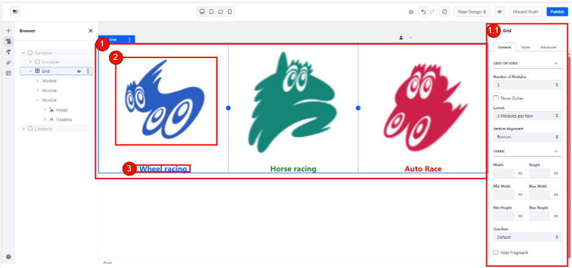
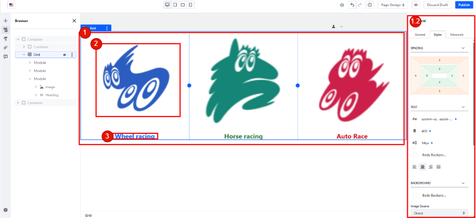
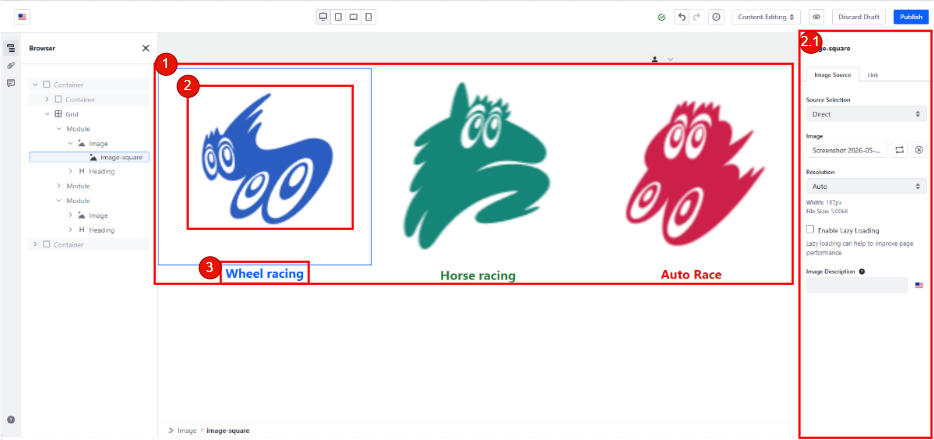
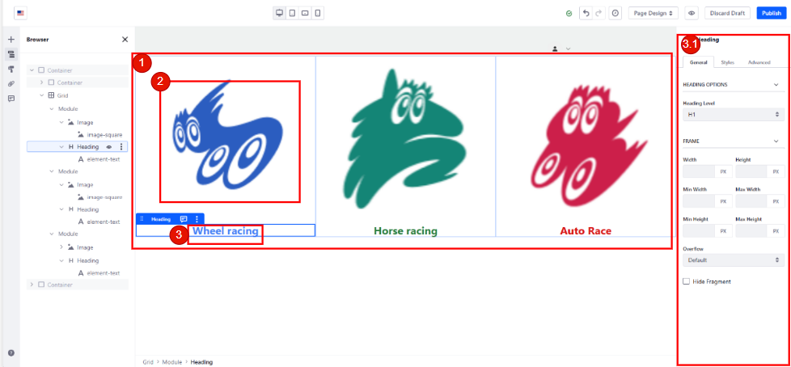
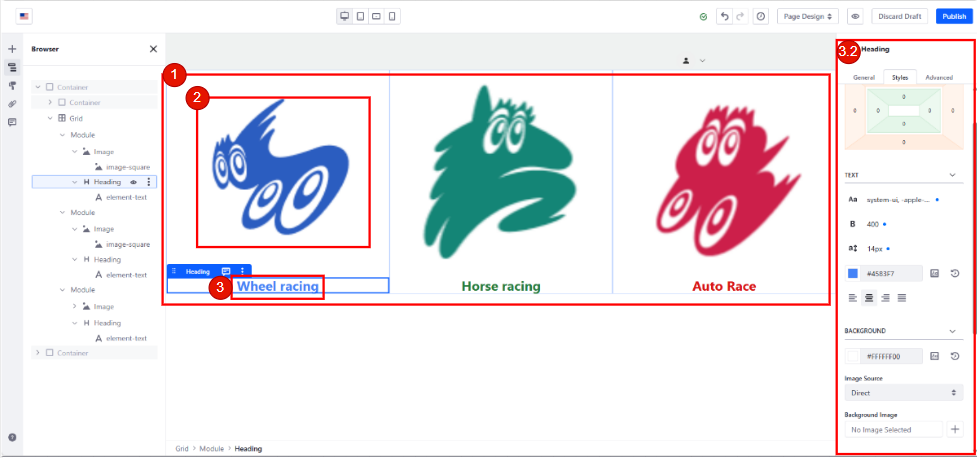
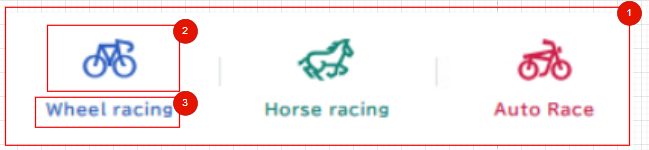
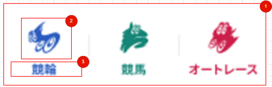

# 【CMSコンテンツ】コンポーネント仕様書_CDBSP0002_Campaign Detail Web Content

## 1. 表紙

<h1 style="text-align:center;">

ネット投票システム(RAISE)／コンポーネント仕様書

</h1>

<h3 style="text-align:center;">

```
2026 年 05 月 19日
第 00.01 版
オッズ・パーク株式会社
```

</h3>

## 2. 変更履歴

| 版数  | 変更日         | 変更ID | 変更箇所 | 変更内容 | 更新者 | 承認日付       | 承認者 |
| ----- | -------------- | :----- | -------- | -------- | ------ | -------------- | ------ |
| 00.01 | 2026年05月19日 | -      | -        | 新規作成 |        | 2026年05月19日 |        |

## 3. インプット一覧

| ドキュメント     | 詳細                 | ID/No                                       | 名称                                                                                                                                                                                                                                                      |
| ---------------- | -------------------- | ------------------------------------------- | --------------------------------------------------------------------------------------------------------------------------------------------------------------------------------------------------------------------------------------------------------- |
| 要件定義書       | 業務フロー           | A06-050106 (A06-050106-01_キャンペーン登録) | キャンペーン_運用管理                                                                                                                                                                                                                                     |
| 要件定義書       | 業務処理定義書       | A06-006 (システム化業務詳細)                | キャンペーン運用管理                                                                                                                                                                                                                                      |
| 要件定義書       | システム化業務説明書 | A06-161 (別紙_画面帳票項目)                 | 投票促進・リテンション                                                                                                                                                                                                                                    |
| 現行サイト       |                      |                                             | [https://www.oddspark.com/campaign/campaign.html](https://www.oddspark.com/campaign/campaign.html)                                                                                                                                                           |
| 現行サイト       |                      |                                             | [https://mockup.opnextlab.click/proto-pages/campaign/cm_cp_list01](https://mockup.opnextlab.click/proto-pages/campaign/cm_cp_list01)                                                                                                                         |
| ワイヤーフレーム |                      |                                             | [OddsPark_Phase2-2_画面デザイン確認用](https://www.figma.com/design/gmMKkIzJDJG1LHp6tc6FmK/OddsPark_Phase2-2_%E7%94%BB%E9%9D%A2%E3%83%86%E3%82%99%E3%82%B5%E3%82%99%E3%82%A4%E3%83%B3%E7%A2%BA%E8%AA%8D%E7%94%A8?node-id=629-72827&t=ETQoh05uqY2RyUP6-1) |

## 4. Author Configurations

### 4.1 画面レイアウト (Screen Layout)












### 4.2 項目説明 (Item Description)

* Other fields captured in the UI belong to OOTB of CMS and are not related to this requirement. Refer to official guide document from Liferay here: https://learn.liferay.com/w/dxp/content-management-system/web-content/web-content-articles/creating-web-content-articles

| 項番 | 項目名 (業務)       | 種類               | 必須 | OOTB | 備考                                                                                                                                                                                                                                                                                                                                                                           |
| ---- | ------------------- | ------------------ | ---- | ---- | ------------------------------------------------------------------------------------------------------------------------------------------------------------------------------------------------------------------------------------------------------------------------------------------------------------------------------------------------------------------------------ |
| 1    | Carousel            | Component          | O    | X    | Cho phép user thiết kế và tạo giao diện hiển thị cho Carousel                                                                                                                                                                                                                                                                                                          |
| 1.1  | Bố trí Carousel   | DropDown/ Checkbox | O    | X    | Cho phép User chọn số module trong 1 Grid với giá trị từ 1-12<br />+ Khi kéo thả grid mặc định là 3<br />+ Checkbox: bật tắt Gutter<br />+ Số banner trên 1 hàng:  mặc định là số module đã chọn trên hàng/ Tùy chọn mỗi hàng 1 module                                                                                                        |
| 1.2  | Kiểu Carousel      | Grid Style         | O    | X    | + Cho phép user căn lề padding margin cho grid xuất hiện ở trang web<br />+ Lựa chọn kiểu chữ gồm : In đậm, màu, cách căn lề<br />+ Lựa chọn màu background cho Carousel<br />+ Thêm ảnh cho background (Direct/Mapping)                                                                                                                                |
| 2    | Banner Card         | Component          | O    | X    | Double click để hiển thị cấu hình ảnh và LinkUser có thể thực hiện các thao tác sau:<br />+ Drag and drop để thay đổi vị trí các Card                                                                                                                                                                                                                     |
| 2.1  | Image               | Attachment         | O    | X    | Hiển thị Khi user ấn vào Banner Card Chi tiết tham khảo Liferay User Manual:[Link](https://learn.liferay.com/w/dxp/sites/creating-pages/page-fragments-and-widgets/using-fragments/configuring-fragments/fragment-elements-reference)                                                                                                                                      |
| 2.2  | Link                | DropDown/ Text    | O    | X    | Hiển thị khi user ấn vào Tab Link<br />Cho phép user chọn source link cho ảnh banner, bao gồm các lựa chọn sau:<br />+ URL<br />+ Page URL<br />+ Mapped URL<br />Chi tiết tham khảo Liferay User Manual: [Link](https://learn.liferay.com/w/dxp/sites/creating-pages/page-fragments-and-widgets/using-fragments/configuring-fragments/fragment-elements-reference) |
| 3    | Banner Card's Name  | Text input         | O    | X    | Double-click để nhập tên từng Banner Card                                                                                                                                                                                                                                                                                                                                |
| 3.1  | Card's Name General | DropDown/ Text    | O    | X    | Cho phép user chọn Level Headling để tăng giảm kích thước của văn bản<br />Chọn kiểu xử lí container (Overflow)                                                                                                                                                                                                                                                |
| 3.2  | Card's Name Style   | Text style         | O    | X    | + Cho phép user căn lề padding margin cho grid xuất hiện ở trang web<br />+ Chọn kiểu chữ<br />+ Chọn độ đậm cho chữ<br />+ Chọn khoảng cách giữa các dòng<br />+ Lựa chọn kiểu chữ gồm : In đậm, màu, cách căn lề<br />+ Lựa chọn màu background cho ô text<br />+ Thêm ảnh cho background (Direct/Mapping)                            |

## 5. Frontend Display

### 5.1 画面レイアウト (Screen Layout)

#### 5.1.1. デスクトップ (Desktop)

[ ]()

#### 5.1.2. モバイル (Mobile)



### 5.2 項目説明

| No | 項目名称           | イベント\`\` | イベント内容\`\`                                                                                                                 | ソース\`\` | 備考\`\` |
| :-: | ------------------ | ------------ | -------------------------------------------------------------------------------------------------------------------------------- | ---------- | -------- |
| 1 | Carousel Container | Load         | Khi người dùng truy cập trang, hiển thị ảnh banner đã được cấu hình trong mục 1.1 phần 4.2 Author Configuration | CMS        |          |
| 2 | Banner Card        | Load         | Hiển thị ảnh đã cấu hình trong mục 4.2 Author Configuration                                                              | CMS        |          |
| 2 | Banner Card        | Click        | Điều hướng người dùng đến friendly URL của Navigation tương ứng                                                     | CMS        |          |
| 3 | Component Title    | Load         | Hiển thị tiêu đề của từng Banner Card                                                                                     | CMS        |          |

## 6. 補足
